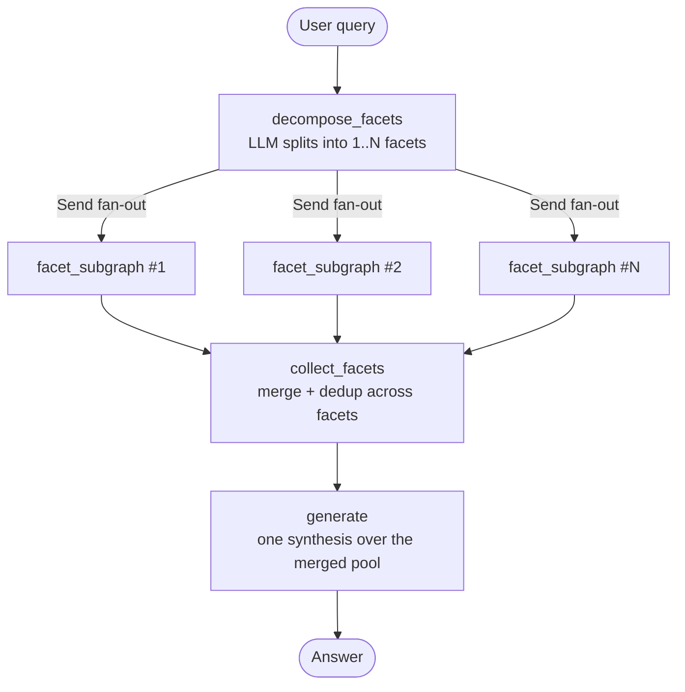
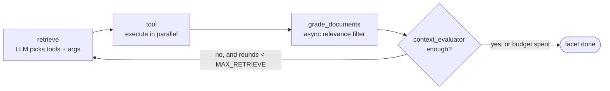

# 📚 Document CRAG: Corrective RAG with Hierarchical Tree Indexing

[](https://www.python.org/downloads/)
[](https://github.com/langchain-ai/langgraph)
[](https://github.com/langchain-ai/langchain)
[](https://opensource.org/licenses/MIT)

A question-answering system for long structured documents (built and benchmarked on a
Vietnamese law textbook). It indexes a document as a **hierarchical tree** that mirrors the
document's own heading structure, then answers with a **LangGraph agent** that splits a
question into facets, retrieves for each facet in parallel, grades what it finds, and
retries the parts that are still thin before writing a single grounded answer.

Every change is measured: the repo ships a **Gradio LLM-as-a-Judge dashboard**, a 30-question
benchmark, and the score/trajectory history of each run under `data/test/<topic>/`.

---

## 🔭 System Flow

Two levels. The parent graph splits the question and fans out; each facet runs its own
corrective retrieval loop with its own budget; results are merged once before generation.



Inside **each** `facet_subgraph` — N copies run concurrently, each with its own documents,
search history and retry counter:



| Node | Decides | Writes to state |
| :--- | :--- | :--- |
| `decompose_facets` | Whether the question has several facets (a comparison always does) and what each sub-question is | `facet_queries` |
| `retrieve` | Which tools to call with which arguments this round; drops any `(tool, query)` pair already tried | `tool_calls` |
| `tool` | — (executes the calls concurrently, splits output into chunks, dedups across rounds) | `pending_documents`, `search_history`, `node_digest` |
| `grade_documents` | Which new chunks are relevant enough to keep, and which are on-topic but incomplete (drill-down candidates) | `documents`, `document_priorities`, `drill_candidates` |
| `context_evaluator` | Whether this facet's context is sufficient; if not, what to search next | `context_sufficient`, `missing_aspects`, `feedback` |
| `collect_facets` | — (merges and dedups documents across facets, once) | `documents`, `facet_sufficiency` |
| `generate` | The final answer, trimmed to `CONTEXT_BUDGET_CHARS` by chunk quality, not recency | `generation` |

Loop budget is `AgentConfig.MAX_RETRIEVE` (5) **per facet**, plus a no-progress guard that
exits early when two consecutive rounds bring in nothing new.

---

## 🔍 Retrieval Tools

The agent binds five tools and picks per facet:

| Tool | Use |
| :--- | :--- |
| `semantic_search` | Concept queries — definitions, explanations, "what is / how does" |
| `keyword_search` | Exact terms — named exceptions, legal institutions, article numbers (BM25) |
| `expand_node(node_id, direction)` | **Drill-down.** `children` for detail under a summary, `parent` for broader context, `siblings` for the other items in the same list |
| `find_in_subtree(root_node_id, patterns)` | Search *inside* one branch for a specific fact, instead of reading the whole branch |
| `web_search` | Only when the documents clearly do not cover the topic (disabled during closed-book benchmarks) |

The drill-down pair (`expand_node` / `find_in_subtree`) is what separates this from flat RAG:
once a search lands on the right section, the agent navigates the tree instead of re-searching
and hoping for a better embedding hit.

---

## 📊 Evaluation

### How answers are scored

Four criteria on a 10-point scale — **each scored by its own independent prompt**, run
concurrently. One combined prompt makes the scores drift together (halo effect: a verbose
answer gets marked down on *every* axis, not just relevance). Splitting them costs 4 LLM
calls instead of 1 but no extra wall-clock, since they run in parallel.

| Criterion | Asks |
| :--- | :--- |
| **Accuracy** | Is it factually right against the reference answer? |
| **Completeness** | Does it cover every point the reference makes? |
| **Relevance** | Is it on-target and concise, without padding? |
| **Faithfulness** | Is every claim grounded in the retrieved chunks (anti-hallucination)? |

`total_score` is the plain mean of the four.

### Diagnostic metrics (deterministic, no LLM)

Judge scores say *how good*; these say *which layer leaked*:

| Metric | Measures |
| :--- | :--- |
| `coverage_pct` | Reference keywords present in the retrieved chunks (substring match, kept for historical comparability) |
| `coverage_pct_strict` | Same, with word-boundary matching and stopwords removed |
| `answer_coverage_pct` | Reference keywords present in the **final answer** |
| `utilization_pct` | `answer_coverage / coverage_strict` — how much of what was retrieved actually got used |

Reading them together isolates the failing stage:

- **Low chunk coverage** → retrieval problem. The material never arrived.
- **High chunk coverage, low utilization** → generation problem. The material arrived and
  was not used (answer truncated, or the model hedged instead of answering).
- **High coverage, high utilization, low judge score** → suspect the reference or the judge,
  not the agent.

Full worked examples with real question numbers are in the docstring of
`calculate_answer_coverage` (`src/slidegen_rag/evaluate/metrics.py`).

### Two ways to run a benchmark

| Mode | What it does | Cost |
| :--- | :--- | :--- |
| **Full run** | Runs the agent end-to-end, then judges. Writes `answer.txt`, `chunks.txt`, `generate_state.json`, `trajectory.txt` | ~31 min, ~$0.27 for 30 questions |
| **Regenerate only** | Reuses the chunks already in `chunks.txt`, re-runs **only** `generate`, then judges | ~3 min |

Regenerate-only exists for prompt iteration on the synthesis step: because the chunks are
frozen, any score difference comes from the generation prompt and not from retrieval drifting
between runs. It requires `generate_state.json` (the per-question `facet_sufficiency` and
`document_priorities` from the last full run) and **refuses to run without it** — without
that file every question is told its context is complete, which silently flips the behaviour
of exactly the questions whose correct answer is "the document does not cover this".

### Reading the numbers

Judge noise is **±0.06**: re-scoring one identical set of answers four times gave 8.03 /
8.03 / 8.05 / 8.09. **Treat any gap below ~0.1 as noise.** Per-question differences are far
larger than the average suggests — a single rescued question can move the mean by 0.25, so
check the per-question CSV before concluding that a change helped.

### Latest results

Run `20260915_192417` — 30 questions, `gemini-3.5-flash-lite` for retrieval/decompose/
evaluation, self-hosted model for generation, web search off (closed-book).

| Metric | Score |
| :--- | :---: |
| **Total** | **8.54 / 10** |
| Accuracy | 8.22 |
| Completeness | 8.38 |
| Relevance | 8.42 |
| Faithfulness | 9.15 |
| Chunk coverage | 81.1% |
| Answer coverage | 73.5% |
| Utilization | 94.0% |

30/30 questions completed, ~10 chunks per question, $0.27 and 31.5 minutes for the run.
Every previous run is kept as `scores_<timestamp>.csv` + `summary_<timestamp>.json` in
`data/test/pldc_v2/` — including the ones that got *worse*, since a regression you can
reproduce is worth more than a number you can't.

---

## 🌟 Other Features

- **Tree index from the document's own headings** (`tree/`): numeric depth detection
  (`1.1.2.1`), chapter keyword normalization, OCR bullet-noise stripping, and bottom-up LLM
  summarization of parent nodes. Nodes keep line-span provenance, which the drill-down tools
  depend on.
- **Multi-provider LLM routing** (`agent/models/llm.py`): local OpenAI-compatible endpoint
  (vLLM / NIM / DeepSeek) with automatic fallback to Gemini on context overflow, plus token
  and USD/VND cost tracking split by provider.
- **LangSmith tracing + trajectory recorder** (`agent/observability/`): one graph run
  reconstructs the full trajectory — tools called with arguments, retrieve rounds per facet,
  evaluator feedback per round, per-node latency, token cost. Fail-soft: no API key just
  disables tracing.
- **Guards learned from real failures**: a cap on tool calls per round (one degenerate run
  emitted 517 in a single step), a repetition guard on generated text, and a hard stop when
  benchmark inputs are missing. Each is documented at its definition with the run that
  motivated it.

---

## 🏗️ Project Structure

```
slidegen-rag/
├── src/slidegen_rag/
│   ├── agent/
│   │   ├── graph/             # State machine: builder, router, parent + facet state
│   │   │   ├── builder.py     # Parent graph: decompose → fan-out → collect → generate
│   │   │   ├── facet_subgraph.py  # Per-facet retrieve→tool→grade→evaluate loop
│   │   │   ├── router.py      # Loop-exit logic (budget + no-progress guard)
│   │   │   ├── state.py       # AgentState + make_initial_state
│   │   │   └── conversation.py    # Multi-turn history for the CLI
│   │   ├── models/llm.py      # Multi-provider LLM wrapper & TokenTracker
│   │   ├── nodes/             # One file per graph node
│   │   ├── observability/     # LangSmith tracing, trajectory recorder
│   │   ├── tools/tools.py     # Semantic / BM25 / drill-down / web search
│   │   └── utils/             # prompts, context budget, document merge, text guard
│   ├── evaluate/              # Gradio LLM-as-a-Judge dashboard
│   │   ├── settings.py        # Paths, display thresholds, process-wide setup
│   │   ├── io.py              # Read/write question, answer, chunks, state files
│   │   ├── metrics.py         # Deterministic coverage metrics
│   │   ├── judge.py           # 4 independent per-criterion judge prompts
│   │   ├── runner.py          # Run agent / reuse cache / regenerate, then score
│   │   ├── report.py          # KPI cards, charts, CSV+JSON export
│   │   ├── app.py             # Gradio layout & handlers (entry point)
│   │   └── evaluate.py        # Back-compat re-export shim
│   ├── tree/                  # Hierarchical index: builder, models, retriever, structure
│   ├── config.py              # Central config (models, thresholds, paths, loop budget)
│   ├── ingest.py              # CLI: build & serialize trees
│   └── main.py                # CLI: interactive Q&A / single query
├── data/
│   ├── src/                   # Raw Markdown sources
│   ├── index/                 # Serialized tree indices (.pkl)
│   └── test/<topic>/          # Benchmarks: questions, references, cached answers,
│                              # chunks, trajectories, and every run's scores
├── scripts/                   # One-off tools (index migration, token report, scraper)
└── tests/unit/                # Unit tests (uv run pytest)
```

---

## 🚀 Getting Started

### 1. Prerequisites

- Python `>= 3.12`
- [`uv`](https://docs.astral.sh/uv/) (recommended) or `pip`

### 2. Installation

```bash
git clone https://github.com/kohaku4869/slidegen-rag.git
cd slidegen-rag
uv sync
```

### 3. Environment Configuration

Create a `.env` file in the root directory:

```env
# Google Gemini API
GEMINI_API_KEY="your-gemini-api-key"
GEMINI_MODEL="gemini-3.5-flash-lite"

# Tavily Web Search API (Optional for web search tool)
TAVILY_API_KEY="your-tavily-api-key"

# Local / OpenAI-Compatible Endpoint (Optional for local summarizer/grader/generator)
LLM_BASE_URL="http://your-vllm-or-nim-server:8080/v1"
LLM_API_KEY="your-api-key"

# Remote Embedding Server (Optional, defaults to local BAAI/bge-m3)
EMBEDDING_BASE_URL=""

# LangSmith Tracing (Optional — enables trace links in trajectory.txt and on smith.langchain.com)
LANGSMITH_TRACING="true"
LANGSMITH_ENDPOINT="https://api.smith.langchain.com"
LANGSMITH_API_KEY="your-langsmith-api-key"
LANGSMITH_PROJECT="slidegen-rag"
```

> Everything except `GEMINI_API_KEY` is optional and fail-soft: a missing LangSmith key
> disables tracing with a warning, a missing Tavily key disables web search, and a missing
> local endpoint falls back to Gemini.

---

## 📖 Usage Guide

> The package lives under `src/slidegen_rag/`. Run everything through
> `uv run slidegen-<name>` or `uv run python -m slidegen_rag.<module>` — plain
> `python main.py` does not resolve.

### 1. Ingest documents (build the tree index)

Parses Markdown in `data/src/` and writes `.pkl` indices to `data/index/`:

```bash
uv run slidegen-ingest
uv run slidegen-ingest --file data/src/pldc.md --force
```

### 2. Ask questions

```bash
# Interactive chat
uv run slidegen-ask

# Single query
uv run slidegen-ask --query "Quy phạm pháp luật là gì?"

# Show tool calls, grading, and evaluator feedback as it runs
uv run slidegen-ask --verbose

# Save the full execution trajectory of one query
uv run slidegen-ask --query "Quy phạm pháp luật là gì?" --trajectory out/trajectory.txt
```

### 3. Run the evaluation dashboard

```bash
uv run python -m slidegen_rag.evaluate.evaluate
```

Opens on `http://localhost:7860`. Pick a topic, then either **Bắt đầu đánh giá** (full run)
or **Chỉ chạy lại Generate** (regenerate-only, see above). The dashboard shows KPI cards,
charts, a per-question table, and a Question Inspector with that question's answer, chunks,
judge feedback and agent trajectory. Each run exports
`data/test/<topic>/scores_<timestamp>.csv` and `summary_<timestamp>.json`.

### 4. Tests and linting

```bash
uv run pytest -m "not live"
uv run ruff check .
uv run ruff format .
```

---

## 🛠️ Tech Stack

- **Orchestration**: [LangGraph](https://github.com/langchain-ai/langgraph), [LangChain](https://github.com/langchain-ai/langchain)
- **Language models**: Google Gemini (`LLMConfig.MODEL`) with OpenAI-compatible local endpoints (vLLM / NIM / DeepSeek)
- **Embeddings & search**: BAAI/bge-m3 (Sentence-Transformers), Rank-BM25, Tavily Search API
- **Evaluation & UI**: Gradio, Matplotlib, Pydantic, Pandas
- **Observability**: LangSmith, Tiktoken

---

## 📄 License

This project is licensed under the MIT License. See [LICENSE](LICENSE) for details.
