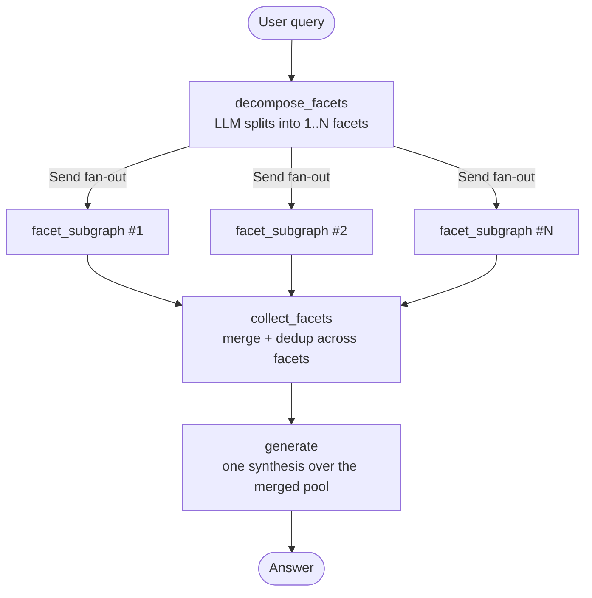

# 📚 HRAG: Hierarchical Agentic RAG

[](https://www.python.org/downloads/)
[](https://github.com/langchain-ai/langgraph)
[](https://github.com/langchain-ai/langchain)
[](https://opensource.org/licenses/MIT)

**HRAG** (Hierarchical Agentic RAG) is a question-answering system for long structured documents (built and benchmarked on a
Vietnamese law textbook). It indexes a document as a **hierarchical tree** that mirrors the
document's own heading structure, then answers with a **LangGraph agent** that splits a
question into facets, retrieves for each facet in parallel, grades what it finds, and
retries the parts that are still thin before writing a single grounded answer.

> **Naming.** The project was previously called *Document CRAG*. HRAG is the project's
> display name; the repository, Python package and CLI commands keep their original
> `slidegen-rag` / `slidegen_rag` / `slidegen-*` names, so nothing in the commands below changed.

| System (30 Vietnamese law questions, LLM judge) | Total score |
|---|---|
| Naive RAG | 5.9 |
| RAPTOR + CRAG | 6.93 |
| Hierarchical tree + CRAG | 7.89 |
| **HRAG (multi-facet agent)** | **8.54** |

Every change is measured: the repo ships a **Gradio LLM-as-a-Judge dashboard**, a 30-question
benchmark, and the score/trajectory history of each run under `data/test/<topic>/`.

---

## 🌳 Indexing

Retrieval quality is capped by the index, so this runs first and offline. One command turns
a Markdown file into a serialized tree:

```bash
uv run slidegen-ingest --file data/src/pldc.md
```

### 1. Parse headings into a hierarchy

The tree mirrors the document's **own** structure rather than a fixed-size chunker. Four
rules, each derived from failures on a real OCR'd textbook (`tree_builder.py`):

| Rule | Why |
| :--- | :--- |
| Numeric depth wins (`1.1.2.1` → level 4) | The `#` count is unreliable in converted documents |
| Chapter keywords (`CHƯƠNG`, `PHẦN`, …) force level 1 | OCR frequently demotes chapter titles |
| Strip `*`, `_`, `` ` ``, `~` before matching | Inline formatting otherwise breaks title matching |
| A line starting with `-`, `+`, `•`, `*` after a `#` is **content**, not a heading | OCR tools tag list items as headings |

Each node records where it came from: `heading_path` (breadcrumb of ancestors),
`line_start`/`line_end` for its whole subtree, and `body_line_start`/`body_line_end` for its
own text. That line-span provenance is what makes the `expand_node` / `find_in_subtree`
drill-down tools possible later.

### 2. Summarize bottom-up, one layer at a time

Layer 0 is the document's own text — leaves are **never** rewritten, only embedded. Each
layer above is built by concatenating a node's children and summarizing them with an LLM
(`SUMMARIZATION_LENGTH` = 2000 tokens), batched per layer. Embeddings are `BAAI/bge-m3`
(1024-dim), remote endpoint first with local fallback.

The result for the benchmark document (`data/index/pldc_v2.pkl`):

```
layer 4 ──   1 node    root (whole-document summary)
layer 3 ──  16 nodes   ↑ summaries
layer 2 ──  26 nodes   ↑ summaries
layer 1 ──  61 nodes   ↑ summaries
layer 0 ── 216 nodes   leaves = original text, no LLM rewriting
           ─────────
           320 nodes total, 5 layers
```

Having both levels matters at query time: a broad question matches a summary node, a
specific one matches a leaf, and the agent can move between them instead of hoping a single
flat chunk size fits both.

### 3. Serialize

The tree is pickled to `data/index/<name>.pkl` with `schema_version`, `source_sha1`, the
stripped `source_text`, and a `parent_of` reverse map. Keeping `source_text` in the index is
what lets the retrieval tools resolve a node back to exact source lines. Ingestion prints a
per-layer report (node counts, LLM calls, summarize vs embed time, bottleneck analysis).

> `.pkl` indices built before the v2 schema still load — `Node`/`Tree` declare every v2
> field as a class-level default, so old pickles read back without `AttributeError`. They
> just lack provenance, so drill-down is degraded; `scripts/migrate_index_v2.py` backfills.

### What building it costs

For the benchmark document (534K characters, 5,491 lines → 320 nodes):

| Stage | Work | Time |
| :--- | :--- | :--- |
| Parse headings → hierarchy | 5,491 lines → 319 nodes | 7 ms |
| Embed | 320 nodes (1024-dim each) | endpoint-dependent |
| Summarize | 103 LLM calls, batched per layer | endpoint-dependent |
| **End-to-end** | | **~5+ minutes** |

Parsing is free — it is pure text processing and never the bottleneck. Practically all of
the ~5 minutes is the 103 summarization calls and 320 embeddings, so the figure moves with
wherever you point `EMBEDDING_BASE_URL` and `LLM_BASE_URL`; the counts are given alongside
it because those stay true on any setup.

Ingestion is a **one-off**: the index is reused by every query and every benchmark run, so
those 5 minutes are paid once per document version, not per question. For scale, a single
full 30-question benchmark run takes 6× longer than building the index it reads.

> Worth knowing before you run it: with `EMBEDDING_BASE_URL` unset or unreachable the
> embedder falls back to a local `BAAI/bge-m3`, and on a CPU-only box that fallback needs
> more than 1.4 GB for a single batch — it will OOM rather than run slowly. Point it at a
> working endpoint, or expect to need a GPU.

---

## 🔭 System Flow

Two levels. The parent graph splits the question and fans out; each facet runs its own
corrective retrieval loop with its own budget; results are merged once before generation.



Inside **each** `facet_subgraph` — N copies run concurrently, each with its own documents,
search history and retry counter:


| Node | Decides | Writes to state |
| :--- | :--- | :--- |
| `decompose_facets` | Whether the question has several facets (a comparison always does) and what each sub-question is | `facet_queries` |
| `retrieve` | Which tools to call with which arguments this round; drops any `(tool, query)` pair already tried | `tool_calls` |
| `tool` | — (executes the calls concurrently, splits output into chunks, dedups across rounds) | `pending_documents`, `search_history`, `node_digest` |
| `grade_documents` | Which new chunks are relevant enough to keep, and which are on-topic but incomplete (drill-down candidates) | `documents`, `document_priorities`, `drill_candidates` |
| `context_evaluator` | Whether this facet's context is sufficient; if not, what to search next | `context_sufficient`, `missing_aspects`, `feedback` |
| `collect_facets` | — (merges and dedups documents across facets, once) | `documents`, `facet_sufficiency` |
| `generate` | The final answer, trimmed to `CONTEXT_BUDGET_CHARS` by chunk quality, not recency | `generation` |

Loop budget is `AgentConfig.MAX_RETRIEVE` (5) **per facet**, plus a no-progress guard that
exits early when two consecutive rounds bring in nothing new.

---

## 🔍 Retrieval Tools

The agent binds five tools and picks per facet:

| Tool | Use |
| :--- | :--- |
| `semantic_search` | Concept queries — definitions, explanations, "what is / how does" |
| `keyword_search` | Exact terms — named exceptions, legal institutions, article numbers (BM25) |
| `expand_node(node_id, direction)` | **Drill-down.** `children` for detail under a summary, `parent` for broader context, `siblings` for the other items in the same list |
| `find_in_subtree(root_node_id, patterns)` | Search *inside* one branch for a specific fact, instead of reading the whole branch |
| `web_search` | Only when the documents clearly do not cover the topic (disabled during closed-book benchmarks) |

The drill-down pair (`expand_node` / `find_in_subtree`) is what separates this from flat RAG:
once a search lands on the right section, the agent navigates the tree instead of re-searching
and hoping for a better embedding hit.

---

## 📊 Evaluation

### How answers are scored

Four criteria on a 10-point scale — **each scored by its own independent prompt**, run
concurrently. One combined prompt makes the scores drift together (halo effect: a verbose
answer gets marked down on *every* axis, not just relevance). Splitting them costs 4 LLM
calls instead of 1 but no extra wall-clock, since they run in parallel.

| Criterion | Asks |
| :--- | :--- |
| **Accuracy** | Is it factually right against the reference answer? |
| **Completeness** | Does it cover every point the reference makes? |
| **Relevance** | Is it on-target and concise, without padding? |
| **Faithfulness** | Is every claim grounded in the retrieved chunks (anti-hallucination)? |

`total_score` is the plain mean of the four.

### Diagnostic metrics (deterministic, no LLM)

Judge scores say *how good*; these say *which layer leaked*:

| Metric | Measures |
| :--- | :--- |
| `coverage_pct` | Reference keywords present in the retrieved chunks (substring match, kept for historical comparability) |
| `coverage_pct_strict` | Same, with word-boundary matching and stopwords removed |
| `answer_coverage_pct` | Reference keywords present in the **final answer** |
| `utilization_pct` | `answer_coverage / coverage_strict` — how much of what was retrieved actually got used |

Reading them together isolates the failing stage:

- **Low chunk coverage** → retrieval problem. The material never arrived.
- **High chunk coverage, low utilization** → generation problem. The material arrived and
  was not used (answer truncated, or the model hedged instead of answering).
- **High coverage, high utilization, low judge score** → suspect the reference or the judge,
  not the agent.

Full worked examples with real question numbers are in the docstring of
`calculate_answer_coverage` (`src/slidegen_rag/evaluate/metrics.py`).

### Two ways to run a benchmark

| Mode | What it does | Cost |
| :--- | :--- | :--- |
| **Full run** | Runs the agent end-to-end, then judges. Writes `answer.txt`, `chunks.txt`, `generate_state.json`, `trajectory.txt` | ~31 min, ~$0.27 for 30 questions |
| **Regenerate only** | Reuses the chunks already in `chunks.txt`, re-runs **only** `generate`, then judges | ~3 min |

Regenerate-only exists for prompt iteration on the synthesis step: because the chunks are
frozen, any score difference comes from the generation prompt and not from retrieval drifting
between runs. It requires `generate_state.json` (the per-question `facet_sufficiency` and
`document_priorities` from the last full run) and **refuses to run without it** — without
that file every question is told its context is complete, which silently flips the behaviour
of exactly the questions whose correct answer is "the document does not cover this".

### Reading the numbers

Judge noise is **±0.06**: re-scoring one identical set of answers four times gave 8.03 /
8.03 / 8.05 / 8.09. **Treat any gap below ~0.1 as noise.** Per-question differences are far
larger than the average suggests — a single rescued question can move the mean by 0.25, so
check the per-question CSV before concluding that a change helped.

### Latest results

Run `20260915_192417` — 30 questions, `gemini-3.5-flash-lite` for retrieval/decompose/
evaluation, self-hosted model for generation, web search off (closed-book).

| Metric | Score |
| :--- | :---: |
| **Total** | **8.54 / 10** |
| Accuracy | 8.22 |
| Completeness | 8.38 |
| Relevance | 8.42 |
| Faithfulness | 9.15 |
| Chunk coverage | 81.1% |
| Answer coverage | 73.5% |
| Utilization | 94.0% |

30/30 questions completed, ~10 chunks per question, $0.27 and 31.5 minutes for the run.
Every previous run is kept as `scores_<timestamp>.csv` + `summary_<timestamp>.json` in
`data/test/pldc_v2/` — including the ones that got *worse*, since a regression you can
reproduce is worth more than a number you can't.

---

## ⏱️ Latency

Measured from `trajectory.txt`, which records wall-clock time per node on every run.

### Per question

| | Run 8.54 (self-hosted generation) | Run 8.56 (Gemini generation) |
| :--- | :---: | :---: |
| Mean | **63.0s** | **19.1s** |
| Median | 62.6s | 20.1s |
| Fastest | 22.5s | 5.6s |
| Slowest | 100.8s | 56.0s |
| 30 questions total | 31.5 min | 9.6 min |

### Where the time goes

Same 30 questions, same retrieval model, only the generation provider differs:

| Node | Calls | Run 8.54 total | Run 8.56 total |
| :--- | :---: | :---: | :---: |
| `generate` | 30 | **1440.7s** (48.0s each) | **139.5s** (4.7s each) |
| `context_evaluator` | ~200 | 156.0s (0.76s each) | 140.4s (0.71s each) |
| `retrieve` | ~200 | 115.4s (0.56s each) | 111.1s (0.56s each) |
| `tool` | ~200 | 96.6s (0.47s each) | 99.1s (0.50s each) |
| `grade_documents` | ~200 | 48.6s (0.24s each) | 53.8s (0.27s each) |
| `decompose_facets` | 30 | 32.2s (1.07s each) | 28.9s (0.96s each) |

Two things fall out of this:

- **The corrective loop is cheap.** All ~200 rounds of retrieve + tool + grade + evaluate
  cost about **14 seconds per question** combined, and that number barely moves between runs.
  Searching the tree, filtering chunks and deciding whether to retry is not where the time
  goes — the tools themselves average under half a second.
- **Generation decides everything else.** It is 76% of total time in the self-hosted run and
  the single reason 9.6 minutes became 31.5. Swapping that one provider changes latency 3×
  while total score moves 0.02 (inside the ±0.06 judge noise) — so latency and quality are
  independent dials here, and the generation model is the lever.

Loop behaviour on this benchmark: **3.9 of 5 rounds** used on average, with 20/30 questions
spending the full budget — meaning the loop cap, not the sufficiency check, is what usually
ends retrieval.

---

## 🌟 Other Features

- **Tree index from the document's own headings** (`tree/`): numeric depth detection
  (`1.1.2.1`), chapter keyword normalization, OCR bullet-noise stripping, and bottom-up LLM
  summarization of parent nodes. Nodes keep line-span provenance, which the drill-down tools
  depend on.
- **Multi-provider LLM routing** (`agent/models/llm.py`): local OpenAI-compatible endpoint
  (vLLM / NIM / DeepSeek) with automatic fallback to Gemini on context overflow, plus token
  and USD/VND cost tracking split by provider.
- **LangSmith tracing + trajectory recorder** (`agent/observability/`): one graph run
  reconstructs the full trajectory — tools called with arguments, retrieve rounds per facet,
  evaluator feedback per round, per-node latency, token cost. Fail-soft: no API key just
  disables tracing.
- **Guards learned from real failures**: a cap on tool calls per round (one degenerate run
  emitted 517 in a single step), a repetition guard on generated text, and a hard stop when
  benchmark inputs are missing. Each is documented at its definition with the run that
  motivated it.

---

## 🏗️ Project Structure

```
slidegen-rag/
├── src/slidegen_rag/           # Backend package (agent, tree, memory, evaluate, api, CLI)
│   ├── agent/
│   │   ├── graph/             # State machine: builder, router, parent + facet state
│   │   │   ├── builder.py     # Parent graph: decompose → fan-out → collect → generate
│   │   │   ├── facet_subgraph.py  # Per-facet retrieve→tool→grade→evaluate loop
│   │   │   ├── router.py      # Loop-exit logic (budget + no-progress guard)
│   │   │   ├── state.py       # AgentState + make_initial_state
│   │   │   └── conversation.py    # Multi-turn history (CLI, UI, API all use this)
│   │   ├── models/llm.py      # Multi-provider LLM wrapper & TokenTracker
│   │   ├── nodes/             # One file per graph node
│   │   ├── observability/     # LangSmith tracing, trajectory recorder
│   │   ├── tools/tools.py     # Semantic / BM25 / drill-down / web search
│   │   └── utils/             # prompts, context budget, document merge, text guard
│   ├── memory/                 # Postgres-backed session/project/document catalog
│   │   ├── engine.py           # Async SQLAlchemy engine/sessionmaker + ping()
│   │   ├── repository.py       # SessionRepository (Postgres) — chat sessions/messages
│   │   ├── catalog.py          # ProjectRepository/DocumentRepository (Postgres)
│   │   └── memory_store.py, catalog_store.py   # In-memory fallbacks (no DATABASE_URL / tests)
│   ├── api/                    # REST API (FastAPI) — see Usage Guide § REST API
│   │   ├── app.py              # App factory + lifespan bootstrap + CORS
│   │   └── routers/            # projects, documents, jobs, sessions, chat, health
│   ├── services/               # Business logic shared by UI and API (no Streamlit/FastAPI):
│   │                           # tree_cache, ingest, chat, prefilter, jobs, document_loader
│   ├── evaluate/               # Gradio LLM-as-a-Judge dashboard
│   │   ├── settings.py        # Paths, display thresholds, process-wide setup
│   │   ├── io.py              # Read/write question, answer, chunks, state files
│   │   ├── metrics.py         # Deterministic coverage metrics
│   │   ├── judge.py           # 4 independent per-criterion judge prompts
│   │   ├── runner.py          # Run agent / reuse cache / regenerate, then score
│   │   ├── report.py          # KPI cards, charts, CSV+JSON export
│   │   ├── app.py             # Gradio layout & handlers (entry point)
│   │   └── evaluate.py        # Back-compat re-export shim
│   ├── tree/                  # Hierarchical index: builder, models, retriever, structure
│   ├── config.py              # Central config (models, thresholds, paths, loop budget)
│   ├── ingest.py              # CLI: build & serialize trees
│   └── main.py                # CLI: interactive Q&A / single query
├── .streamlit/config.toml       # Streamlit theme
├── ui/                          # Streamlit UI — see Usage Guide § Streamlit UI.
│                                # Separate top-level package, NOT under src/slidegen_rag/,
│                                # so it can be swapped for a different frontend later.
├── migrations/                  # Alembic (async) — projects/documents/sessions schema
├── data/
│   ├── src/                   # Raw sources (.md/.txt/.docx/.pdf)
│   ├── index/                 # Serialized tree indices (.pkl)
│   ├── projects/<project_id>/ # Per-project uploaded docs + indices (UI/API multi-tenant flow)
│   └── test/<topic>/          # Benchmarks: questions, references, cached answers,
│                              # chunks, trajectories, and every run's scores
├── scripts/                   # One-off tools (index migration, token report, scraper)
└── tests/                     # unit/ (incl. unit/api/), ui/, integration/ (needs Postgres)
```

---

## 🚀 Getting Started

### 1. Prerequisites

- Python `>= 3.12`
- [`uv`](https://docs.astral.sh/uv/) (recommended) or `pip`

### 2. Installation

```bash
git clone https://github.com/kohaku4869/slidegen-rag.git
cd slidegen-rag
uv sync
```

### 3. Environment Configuration

Copy the example file and fill in your own keys:

```bash
cp .env.example .env
```

`.env.example` documents every variable (LLM providers, embeddings, LangSmith, Postgres,
API CORS) with placeholder values and a one-line comment on each. The short version:

| Variable | Required for | Fail-soft? |
| :--- | :--- | :--- |
| `GEMINI_API_KEY` | Retrieval/decompose/evaluation LLM calls | No — the one hard requirement |
| `TAVILY_API_KEY` | `web_search` tool | Yes — tool just stays disabled |
| `LLM_BASE_URL` / `LLM_API_KEY` | Local OpenAI-compatible generator (vLLM/NIM/DeepSeek) | Yes — falls back to Gemini |
| `EMBEDDING_BASE_URL` | Remote embedding endpoint | Yes — falls back to local `BAAI/bge-m3` |
| `LANGSMITH_*` | Tracing + trace links in `trajectory.txt` | Yes — tracing just turns off |
| `DATABASE_URL` | Session memory, project/document catalog, the **Streamlit UI**, and the **REST API** | **No** for UI/API (they refuse to start without it) — CLI still works without it (in-memory sessions, lost on exit) |
| `API_CORS_ORIGINS` | REST API — which frontend origin(s) may call it | Yes — defaults to `http://localhost:3000,http://127.0.0.1:3000` |

If you plan to use the Streamlit UI or the REST API, also run the migrations once
`DATABASE_URL` points at a real Postgres:

```bash
uv run alembic upgrade head
```

---

## 📖 Usage Guide

> The package lives under `src/slidegen_rag/`. Run everything through
> `uv run slidegen-<name>` or `uv run python -m slidegen_rag.<module>` — plain
> `python main.py` does not resolve.

### 1. Ingest documents (build the tree index)

Parses the sources in `data/src/` (`.md`, `.txt`, `.docx`, `.pdf`) and writes `.pkl` indices
to `data/index/`. DOCX keeps headings, lists and tables; PDF is plain text extraction (no OCR,
no heading detection — each page becomes a `## Trang N` section). Non-Markdown files are
converted to Markdown first (`services/document_loader.py`):

```bash
uv run slidegen-ingest
uv run slidegen-ingest --file data/src/pldc.md --force
```

### 2. Ask questions

```bash
# Interactive chat
uv run slidegen-ask

# Single query
uv run slidegen-ask --query "Quy phạm pháp luật là gì?"

# Show tool calls, grading, and evaluator feedback as it runs
uv run slidegen-ask --verbose

# Save the full execution trajectory of one query
uv run slidegen-ask --query "Quy phạm pháp luật là gì?" --trajectory out/trajectory.txt
```

### 3. Run the evaluation dashboard

```bash
uv run python -m slidegen_rag.evaluate.evaluate
```

Opens on `http://localhost:7860`. Pick a topic, then either **Bắt đầu đánh giá** (full run)
or **Chỉ chạy lại Generate** (regenerate-only, see above). The dashboard shows KPI cards,
charts, a per-question table, and a Question Inspector with that question's answer, chunks,
judge feedback and agent trajectory. Each run exports
`data/test/<topic>/scores_<timestamp>.csv` and `summary_<timestamp>.json`.

### 4. Streamlit UI — quick demo

A ready-made multipage UI (projects → upload/index documents → chat with citations) for
trying the system without writing any client code. Lives at `ui/` (repo root, **not** under
`src/slidegen_rag/` — it's a separate, swappable frontend). Needs `DATABASE_URL` (see above)
and the migrations applied:

```bash
uv run slidegen-ui          # same as: uv run streamlit run ui/app.py
```

The UI calls `slidegen_rag.services` in-process — it does **not** need `slidegen-api` running.
Opens on `http://localhost:8501`. Create a project, upload a document (`.md`/`.docx`/`.pdf`), wait for the
background indexing job to finish (progress bar polls every second), then open the chat page
and ask questions — citations link back to the exact tree node and source lines.

### 5. REST API — for integrating your own frontend

A FastAPI layer at `src/slidegen_rag/api/` exposing the same projects/documents/sessions/chat
functionality over HTTP, so a separate frontend (web, mobile, another service) can be built
against it instead of embedding Python. Also needs `DATABASE_URL` + migrations — the server
**fails to start** without a reachable Postgres (same policy as the Streamlit UI):

```bash
uv run slidegen-api                                            # 0.0.0.0:8000
uv run uvicorn slidegen_rag.api.app:app --reload --port 8000   # dev, auto-reload
```

Every route is under `/api/v1`, and interactive docs (Swagger UI, generated from the actual
Pydantic schemas) are served at `http://localhost:8000/docs` — that page is the authoritative,
always-up-to-date reference; the table below is a map of what exists.

| Method & path | Purpose |
| :--- | :--- |
| `GET /health`, `GET /health/db` | Liveness / Postgres readiness |
| `POST /projects`, `GET /projects`, `GET\|PATCH\|DELETE /projects/{id}` | Project CRUD |
| `GET /projects/{id}/stats`, `GET /projects/{id}/documents` | Project dashboard data |
| `POST /projects/{id}/documents` | Upload a `.md`/`.txt`/`.docx`/`.pdf` document (multipart: `title`, `file`; `422` if unsupported/empty) |
| `GET\|PATCH\|DELETE /documents/{id}` | Document detail / rename / soft-delete |
| `POST /documents/{id}/index` | Start (re)indexing — returns `202` + `job_id` immediately |
| `GET /documents/{id}/indexes` | History of indexing attempts |
| `GET /jobs/{job_id}` | Poll an indexing job's progress; auto-commits the result once it finishes |
| `POST /projects/{id}/sessions`, `GET /projects/{id}/sessions` | Create / list chat sessions |
| `GET\|PATCH\|DELETE /sessions/{id}`, `POST /sessions/{id}/archive` | Session detail / rename / delete / archive |
| `PUT /sessions/{id}/scope` | Set which documents a session queries |
| `GET /sessions/{id}/messages` | Full message history with citations |
| `POST /sessions/{id}/chat` | Ask one question (plain request/response, no streaming yet) |
| `GET /sessions/{id}/nodes/{node_id}/excerpt` | Source excerpt for a citation chip |

Minimal end-to-end flow with `curl`:

```bash
PROJECT_ID=$(curl -s -X POST localhost:8000/api/v1/projects \
  -H "Content-Type: application/json" -d '{"name": "Demo"}' | jq -r .id)

DOC_ID=$(curl -s -X POST "localhost:8000/api/v1/projects/$PROJECT_ID/documents" \
  -F "title=My doc" -F "file=@data/src/pldc.md" | jq -r .id)

JOB_ID=$(curl -s -X POST "localhost:8000/api/v1/documents/$DOC_ID/index" | jq -r .job_id)
# poll: curl -s localhost:8000/api/v1/jobs/$JOB_ID | jq .state    (until "done")

SESSION_ID=$(curl -s -X POST "localhost:8000/api/v1/projects/$PROJECT_ID/sessions" \
  -H "Content-Type: application/json" -d '{}' | jq -r .id)

curl -s -X PUT "localhost:8000/api/v1/sessions/$SESSION_ID/scope" \
  -H "Content-Type: application/json" -d "{\"document_ids\": [\"$DOC_ID\"]}"

curl -s -X POST "localhost:8000/api/v1/sessions/$SESSION_ID/chat" \
  -H "Content-Type: application/json" -d '{"query": "Tóm tắt tài liệu này"}'
```

No auth in this version — point `API_CORS_ORIGINS` at your frontend's dev origin and treat
the server as trusted-network-only until an auth layer is added.

### 6. Tests and linting

```bash
uv run pytest -m "not live"
uv run pytest tests/unit/api -q   # just the REST API test suite (in-memory repos, no Postgres needed)
uv run ruff check .
uv run ruff format .
```

---

## 🛠️ Tech Stack

- **Orchestration**: [LangGraph](https://github.com/langchain-ai/langgraph), [LangChain](https://github.com/langchain-ai/langchain)
- **Language models**: Google Gemini (`LLMConfig.MODEL`) with OpenAI-compatible local endpoints (vLLM / NIM / DeepSeek)
- **Embeddings & search**: BAAI/bge-m3 (Sentence-Transformers), Rank-BM25, Tavily Search API
- **Evaluation & UI**: Gradio, Matplotlib, Pydantic, Pandas
- **Observability**: LangSmith, Tiktoken

---

## 📄 License

This project is licensed under the MIT License. See [LICENSE](LICENSE) for details.
