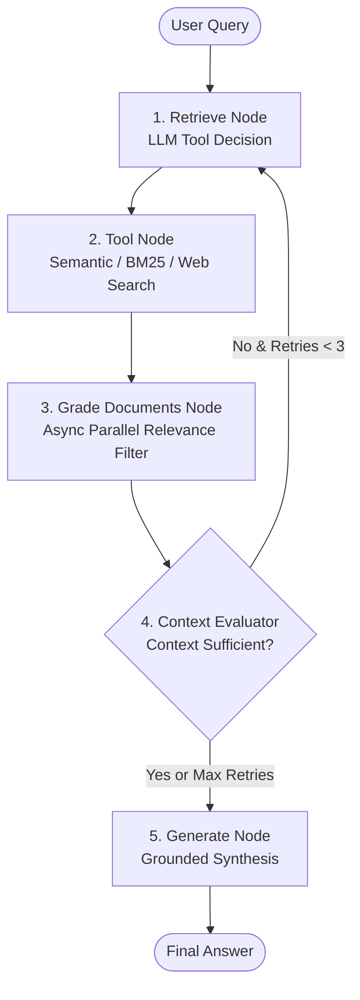

# 📚 Document CRAG: Agentic Corrective RAG with Hierarchical Tree Indexing

[](https://www.python.org/downloads/)
[](https://github.com/langchain-ai/langgraph)
[](https://github.com/langchain-ai/langchain)
[](https://opensource.org/licenses/MIT)

**Document CRAG** is an advanced, production-grade **Agentic Corrective RAG (CRAG)** system engineered for deep document understanding, structured knowledge retrieval, and content grounding (designed for complex domain Q&A, textbook synthesis, and accurate slide content generation).

The system seamlessly combines **RAPTOR-inspired Hierarchical Tree Indexing** with a **LangGraph-driven Corrective RAG feedback loop**, dynamic multi-tool dispatch, parallel document grading, context sufficiency evaluation, and an automated **LLM-as-a-Judge** evaluation dashboard.

---

## 🌟 Key Features

### 🌳 1. RAPTOR-Inspired Hierarchical Tree Indexing
- **Smart Markdown AST Parsing**: Custom parser with numeric depth detection (`1.1.2.1`), chapter keyword normalization, and OCR bullet noise stripping.
- **Multi-Layer Abstraction Tree**: Bottom-up hierarchical clustering and parallel LLM summarization preserving both high-level thematic context and fine-grained section details.
- **Flexible Retrieval Modes**: Supports search across collapsed tree layers or layer-by-layer traversal.

### 🤖 2. Corrective RAG (CRAG) Agent Architecture (LangGraph)
- **Dynamic Retrieval Node**: LLM analyzes queries and decides optimal search strategy (Dense Semantic Search, BM25 Keyword Search, or Tavily Web Search).
- **Parallel Document Grading Node**: Fast asynchronous document relevance grading (`asyncio.Semaphore(16)`) using lightweight LLMs to filter out irrelevant chunks.
- **Context-Sufficiency Evaluator**: Evaluates whether retrieved context is sufficient to answer the prompt; triggers adaptive feedback loops if incomplete (up to 3 iterations).
- **Grounded Generation Node**: Synthesizes clean, comprehensive, and citation-backed responses.



### ⚡ 3. Resilient Multi-Provider LLM & Embedding Infrastructure
- **Hybrid LLM Routing**: Primary support for local OpenAI-compatible endpoints (vLLM / NVIDIA NIM / DeepSeek) with automatic context-overflow fallback to **Google Gemini (Gemini 2.5 Flash / Pro)**.
- **Remote-First Embeddings**: `BAAI/bge-m3` embedding with remote HTTP/ngrok endpoint support and automatic local fallback.
- **Token & Cost Observability**: Built-in real-time tracking of input, output, reasoning tokens, and USD/VND cost estimation.

### 📊 4. Comprehensive Evaluation Suite & Gradio Dashboard
- **LLM-as-a-Judge**: Evaluates 4 core quality dimensions on a 10-point scale:
  - 🎯 **Accuracy**: Factuality against reference answers.
  - 📚 **Completeness**: Coverage of key arguments and legal bases.
  - 🔍 **Relevance**: Conciseness and direct focus.
  - 🛡️ **Faithfulness (Anti-Hallucination)**: Groundedness against retrieved chunks.
- **Interactive Web UI**: Gradio dashboard with KPI metrics, Matplotlib radar/bar charts, and instant caching.
- **Automated Benchmarking**: Headless Playwright script for automated comparison against **Google NotebookLM**.

---

## 🏗️ Project Structure

```
slidegen-rag/
├── agent/
│   ├── graph/                 # LangGraph state machine definition & conditional router
│   │   ├── builder.py         # Graph compilation
│   │   ├── router.py          # Conditional branching logic (retry loop)
│   │   └── state.py           # TypedDict AgentState
│   ├── models/
│   │   └── llm.py             # Multi-provider LLM wrapper & TokenTracker
│   ├── nodes/                 # Graph execution nodes
│   │   ├── retrieve_node.py   # Tool-calling retrieval decision
│   │   ├── tool_node.py       # Parallel search execution
│   │   ├── grade_documents_node.py # Async document relevance filtering
│   │   ├── context_evaluator_node.py # Context sufficiency check
│   │   └── generate_node.py   # Final grounded response synthesis
│   ├── tools/
│   │   └── tools.py           # Semantic search, BM25, and Tavily web search
│   └── utils/
│       └── prompts.py         # Structured system & user prompts
├── config.py                  # Central configuration (models, thresholds, paths)
├── data/
│   ├── src/                   # Raw Markdown source documents (e.g. pldc.md)
│   ├── index/                 # Serialized tree indices (.pkl)
│   └── test/                  # Evaluation benchmarks (questions, references, cache)
├── evaluate.py                # Gradio LLM-as-a-Judge Evaluation Dashboard
├── ingest.py                  # CLI tool to build & serialize hierarchical trees
├── main.py                    # Interactive Q&A CLI / Single query execution
├── pyproject.toml             # Project dependencies & package metadata
├── tree/
│   ├── builder/               # TreeBuilder & Markdown AST hierarchical parser
│   ├── models/                # Embedding & Summarization wrappers
│   ├── retriever/             # TreeRetriever & scoring logic
│   ├── stats.py               # Ingestion stats & layer profiling
│   └── structure/             # Node & Tree data structures
└── test/                      # Benchmarks & NotebookLM Playwright automation
```

---

## 🚀 Getting Started

### 1. Prerequisites
- Python `>= 3.12`
- [`uv`](https://docs.astral.sh/uv/) (recommended) or `pip`

### 2. Installation

Clone the repository and install dependencies:

```bash
git clone https://github.com/kohaku4869/slidegen-rag.git
cd slidegen-rag

# Install dependencies using uv
uv sync
```

### 3. Environment Configuration

Create a `.env` file in the root directory:

```env
# Google Gemini API
GEMINI_API_KEY="your-gemini-api-key"
GEMINI_MODEL="gemini-2.5-flash"

# Tavily Web Search API (Optional for web search tool)
TAVILY_API_KEY="your-tavily-api-key"

# Local / OpenAI-Compatible Endpoint (Optional for local summarizer/grader)
LLM_BASE_URL="http://your-vllm-or-nim-server:8080/v1"
LLM_API_KEY="your-api-key"

# Remote Embedding Server (Optional, defaults to local BAAI/bge-m3)
EMBEDDING_BASE_URL=""
```

---

## 📖 Usage Guide

### 1. Ingest Documents (Build Hierarchical Tree)
Parse raw Markdown documents in `data/src/`, construct hierarchical abstraction trees, and save `.pkl` index files into `data/index/`:

```bash
# Ingest all markdown files in data/src/
uv run python ingest.py

# Ingest a specific file
uv run python ingest.py --file data/src/pldc.md --force
```

### 2. Run Interactive Q&A Agent
Ask questions directly or launch the interactive terminal chat:

```bash
# Interactive Chat Mode
uv run python main.py

# Single Query Mode
uv run python main.py --query "Quy phạm pháp luật là gì?"

# Verbose Mode (Inspect Agent steps, tool calls, and document grading)
uv run python main.py --verbose
```

### 3. Launch Evaluation Dashboard
Start the Gradio web interface to run and inspect **LLM-as-a-Judge** benchmarks:

```bash
uv run python evaluate.py
```
Open your browser at `http://localhost:7860` to view the KPI cards, evaluation radar charts, keyword coverage, and per-question breakdowns.

---

## 📈 Evaluation & Benchmarking

The system is evaluated against reference ground truth datasets across 4 core benchmarks (scored on a 10.0 scale):

| Metric | Score | Description |
| :--- | :---: | :--- |
| **Accuracy** | **9.2 / 10** | Factuality and alignment with authoritative reference material |
| **Completeness** | **8.9 / 10** | Coverage of critical points, sub-clauses, and legal bases |
| **Relevance** | **9.4 / 10** | Directness and focus without extraneous information |
| **Faithfulness** | **9.3 / 10** | Anti-hallucination rate grounded strictly on retrieved chunks |
| **Keyword Coverage** | **88.5%** | Retrieval keyword overlap with reference ground truth |

---

## 🛠️ Tech Stack

- **Frameworks & Orchestration**: [LangGraph](https://github.com/langchain-ai/langgraph), [LangChain](https://github.com/langchain-ai/langchain)
- **Language Models**: Google Gemini 2.5 Flash / Pro, DeepSeek / OpenAI-compatible vLLM
- **Embeddings & Search**: BAAI/bge-m3 (Sentence-Transformers), Rank-BM25, Tavily Search API
- **Evaluation & UI**: Gradio, Matplotlib, Pydantic, Ragas
- **Automation & Profiling**: Playwright Stealth, Tiktoken, Asyncio

---

## 📄 License

This project is licensed under the MIT License. See [LICENSE](LICENSE) for details.